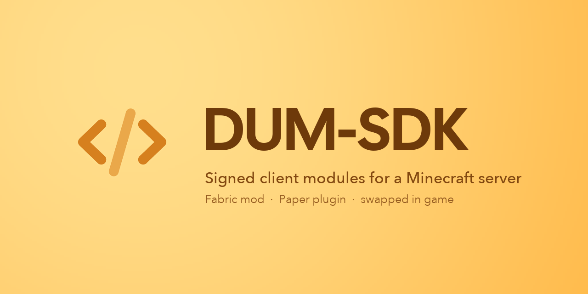
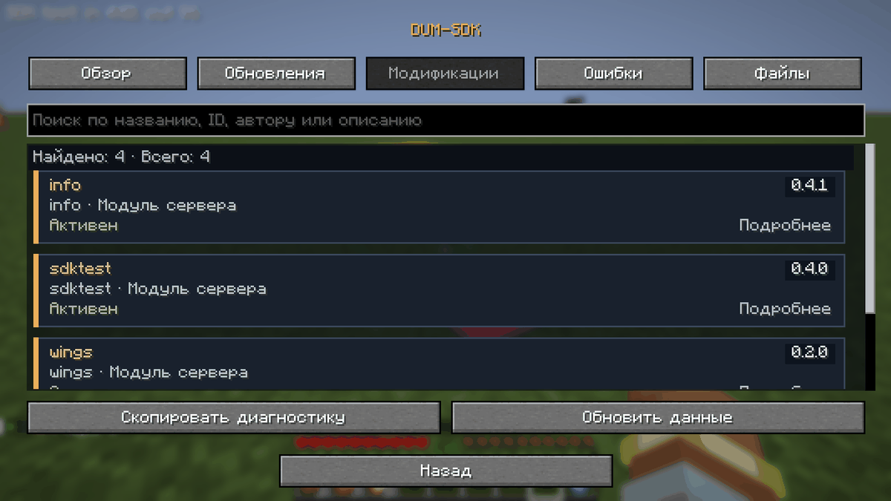
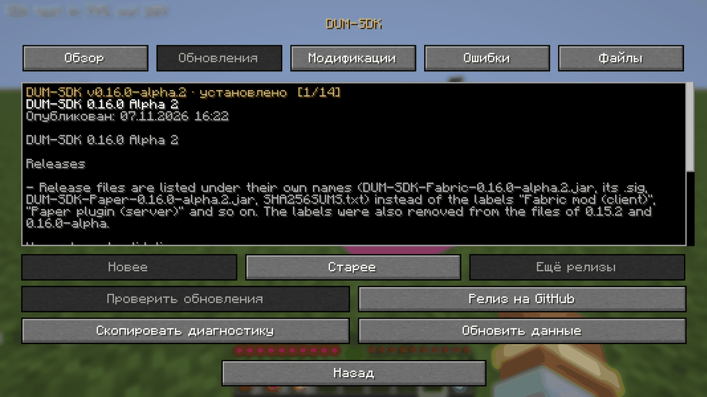
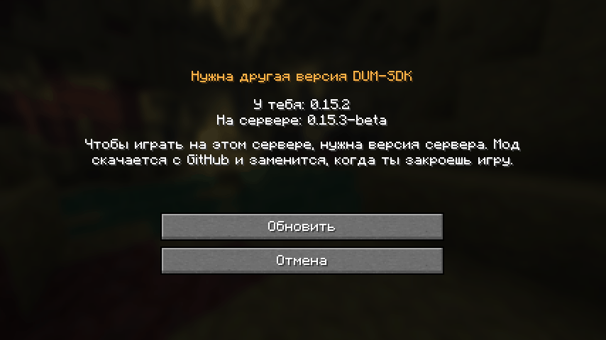
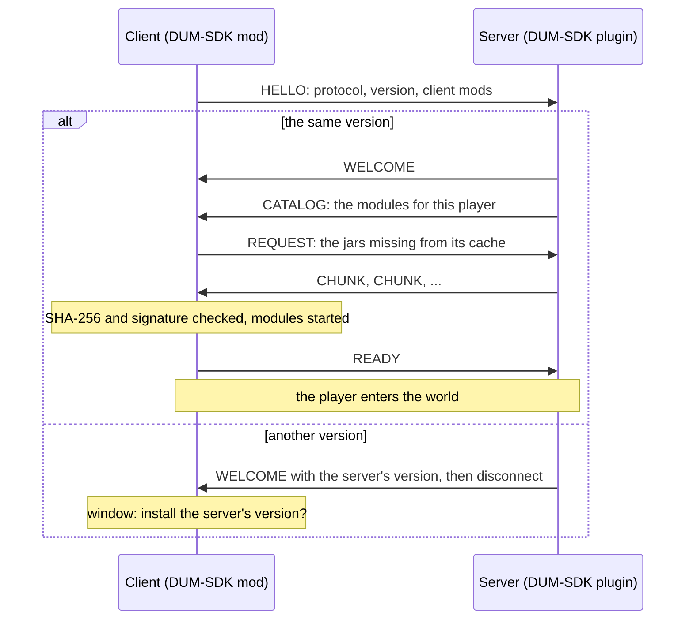
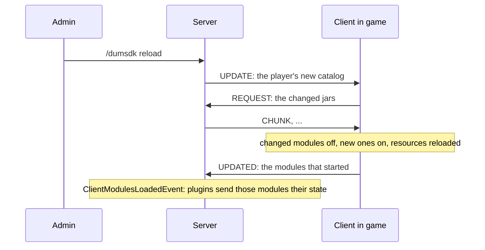

<div align="center">



A Fabric client mod and a Paper plugin: the server hands its players client-side modules when they join, and swaps them in game when it publishes new ones.

<a href="https://github.com/damnurmum/DUM-SDK/releases"></a>


<a href="LICENSE"></a>

</div>

<table>
  <tr>
    <td width="50%"></td>
    <td width="50%"></td>
  </tr>
  <tr>
    <td align="center"><sub>Modules of the server in the DUM-SDK menu</sub></td>
    <td align="center"><sub>Releases and their notes, from GitHub</sub></td>
  </tr>
  <tr>
    <td width="50%"></td>
    <td width="50%" valign="top">

**In short**

- Modules come from the server, signed and checked, and run in their own class loaders while the player is there.
- `/dumsdk reload` publishes new modules; players in game get them without reconnecting.
- The mod and the plugin are one release: a player with another version is offered the server's one, and nothing is downloaded without their consent.
- The server decides the rules; a module only shows and asks. See [fair play](docs/modules.md#fair-play-the-rules-every-module-follows).

**Docs:** [writing modules](docs/modules.md) · [protocol](docs/protocol.md) · [SDK menu](docs/diagnostics.md)

</td>
  </tr>
  <tr>
    <td align="center"><sub>Another version on the server: install it or cancel</sub></td>
    <td></td>
  </tr>
</table>

## Installation

**Players**

1. Minecraft 26.2 with [Fabric Loader](https://fabricmc.net/use/) 0.19.5 or newer and [Fabric API](https://modrinth.com/mod/fabric-api) 0.161.0 or newer (Java 25).
2. Download `DUM-SDK-Fabric-<version>.jar` from [Releases](https://github.com/damnurmum/DUM-SDK/releases) into `mods/`. Take the version the server runs.
3. Join the server. Its modules download and start by themselves; a server with another DUM-SDK version offers to install its own.

**Server owners**

1. Paper 26.2 (Java 25). Put `DUM-SDK-Paper-<version>.jar` into `plugins/` and start the server once.
2. Put signed module jars, each with its `.jar.sig`, into `plugins/DUM-SDK/modules` and run `/dumsdk reload` (permission `dumsdk.admin`). Players in game get them right away.
3. Players need the client mod of exactly the plugin's version. Settings are in `plugins/DUM-SDK/config.yml`: modules for operators only, message limits, and `allow-dev-signed` for a development server only.

## How it works

Joining: the client installs the server's modules before it enters the world.



Publishing: players in game get the new modules without reconnecting.



## Features

- HELLO / WELCOME handshake on the `dum:sdk` channel during the configuration phase. Players without the mod are disconnected before they enter the world.
- Modules may carry `assets/` (textures, models, sounds, lang): while a module runs, its jar is a client resource pack on top of the others, loaded before the player enters the world.
- Modules can add keys (Controls, category DUM; bindings kept between sessions) and client-only entities in the world, such as display entities with models from their assets.
- Cold load: a server-scoped Fabric mod can provide its own mixins and early registrations. SDK 0.14.0 requires it to declare a `dum-sdk:server` entrypoint implementing `DumServerMod`, without startup entrypoints. The client verifies its signature, dependencies and loaded hash; installation/updates require a game restart. Only the current accepted catalog enables its managed effects. Mixins must check `ServerSession.active(modId)`; classes and native registrations remain loaded, so arbitrary third-party mods cannot be automatically suspended. See [the cold mod contract](docs/modules.md#fabric-mods-cold-load).
- DUM-SDK menu (SDK 0.15.0): the Settings button and `/sdk` open Overview, Updates, Errors and Files. Updates includes published release descriptions with an offline cache. An accepted SDK server adds searchable Modifications for published server modules and server Fabric mods. See [the SDK menu](docs/diagnostics.md). Managed runtime failures notify Paper and disconnect for rejoin; details stay in Errors.
- Modules can listen to any Fabric API event (`DumContext.on`), see and drop every packet the client receives or sends (`onReceive` / `onSend`), and draw in the world (`WorldDraw` has shapes that also show with Iris shader packs).
- Modules talk to their server side over `dum:sdk` (`DumContext.sendToServer` / `onServerMessage`) and can draw on and take clicks from game screens.
- Session-scoped appearance hooks let hot modules select armor/wings rendering and define models and names for tagged vanilla items. Their effects require a successful SDK handshake, module installation and play join; they stop on disconnect and stay off on ordinary servers. This does not hot-load arbitrary mixins or add native registry types.
- Client modules come from the server: signed jars in `plugins/DUM-SDK/modules` are sent to the client in the configuration phase, checked (SHA-256 and Ed25519 signature), cached in `.minecraft/dum-sdk/cache` and never taken back to an older version. They are loaded, each in its own class loader, while on the server and unloaded on leaving. A failing module is turned off without taking the game down; after a crash with modules running, the next launch is in safe mode. A server with modules does not let a client in safe mode join (playing without them would be playing by other rules): the player is told to restart the game.

SDK 0.16.0-alpha uses protocol 7, which swaps modules in game after a publication and carries the client's mod list in HELLO. SDK 0.15.x uses protocol 6, SDK 0.14.2 protocol 5 and SDK 0.14.1 protocol 4. Update both client and Paper together: since 0.16.0-alpha a server admits only a client of exactly its version, stage included. See [protocol details](docs/protocol.md).

## Layout

| Project | What it is |
|---|---|
| `dum-network` | Wire format of the `dum:sdk` channel, shared by both sides |
| `dum-fabric` | The client mod (Minecraft 26.2, Fabric) |
| `dum-paper` | The standalone server plugin (Paper 26.2) |

Examples and test fixtures are maintained outside this repository. In the author's workspace they live in the sibling `DUM-SDK-Examples` directory: `info`, its separate Paper plugin, `sdktest` and the cold-load test mod.

## Writing a module

The full guide for module authors is [docs/modules.md](docs/modules.md). In short:

A module is a plain jar with `dum-module.json` at its root:

```json
{
	"id": "example",
	"version": "0.1.0",
	"apiVersion": 1,
	"entrypoint": "com.example.ExampleModule",
	"dependencies": { "other-module": ">=1.0.0" },
	"loadMode": "hot"
}
```

The entrypoint implements `ru.dum.sdk.api.DumModule`. It may use any game or Fabric class directly; whatever it registers through `DumContext` is removed by the SDK when the module is turned off.

## Signing

Clients run only modules signed with the key whose public half is in `Signing.RELEASE_KEY` (`dum-network`). Development clients (`runClient`) also accept `Signing.DEV_KEY`.

Since SDK 0.15.0, cold Fabric mods can export versioned named hooks for hot modules; see [hook contracts](docs/modules.md#versioned-hooks-from-fabric-mods-sdk-0150).

1. Once, on the machine that signs: `./gradlew generateSigningKey`. The private key goes to `~/.dum/signing.key`; keep a copy somewhere safe and never commit it. Put the printed public key into `Signing.RELEASE_KEY`.
2. In `~/.gradle/gradle.properties`: `dumModulesDir=<server>/plugins/DUM-SDK/modules` (and `dumSigningKey=<file>` for a key elsewhere).
3. In the module's own project, run its signing and deployment task (the external examples provide `./gradlew :<project>:deploy`). The server keeps offering its published catalog, including after a Paper restart, until `/dumsdk reload` publishes the staged jars. Players in game get the changed modules right away, without reconnecting (SDK 0.16.0-alpha, protocol 7). On the first startup after upgrading, the current `modules` folder becomes the initial published catalog.

Since SDK 0.15.0, `/dumsdk reload <id> [id ...]` publishes only the selected staged modules or Fabric mods. Other published jars stay unchanged, even if their staged files changed or disappeared. After a successful publication, hot modules are swapped in game; changed Fabric mods still disconnect the player with a request to restart the game. Missing, duplicate or invalid selected jars abort publication without disconnecting online players. See [selective publication](docs/modules.md#publishing).

`./gradlew :dum-fabric:runClient -Prelease` refuses dev-signed modules, like a player's client. Paper leaves dev-signed modules out of the catalog with a warning unless `allow-dev-signed: true` is set in its config (SDK 0.16.0-alpha), so a live server never offers what players' clients refuse; set it only on a development server. `-Psodium` and `-Piris` add Sodium 0.9.2 and Iris 1.11.4 to the dev client (shader packs go into `dum-fabric/run/shaderpacks`).

## Building

Gradle runs on Java 25 and downloads it if needed (`gradle/gradle-daemon-jvm.properties`).

```
./gradlew build
```

The current checkout builds all three projects, including `dum-paper`, without private dependencies or a `dumCorePath` setting. The Paper plugin loads on Paper 26.2 without DUM-Core and owns its messages and handshake lifecycle.

DUM-Core independence starts with 0.14.1. The older v0.14.0 Paper artifact still requires DUM-Core. Existing `config.yml`, `messages.yml`, published catalogs and the `DumSdkApi` service remain supported.

`./gradlew :dum-fabric:runClient -Pjoin=localhost` starts a dev client and connects to a local server.

## Releasing the mod

The mod and the plugin are one release: a server lets in only a client of exactly its DUM-SDK version (SDK 0.16.0-alpha; before, a matching protocol was enough). A client of another version sees a window with both versions and the buttons Cancel and Update, instead of the plain disconnect screen. Nothing is downloaded until the player presses Update: then the mod fetches exactly the server's release from GitHub (older or newer), checks its signature against the release key, and replaces itself when the game closes; the window offers to close the game. The mod no longer checks for updates by itself at game start; Check for updates in the DUM-SDK menu installs the latest release on request. Connection errors and temporary HTTP failures get up to three attempts with 5 and 15 second pauses. Clients up to 0.15.x get the server's text message instead of the window.

A version carries its stage: `X.Y.Z-alpha` and `X.Y.Z-beta` (optionally numbered, `X.Y.Z-alpha.2`) come before the release `X.Y.Z`, and the stage goes into the tag (`v0.16.0-alpha`), the file names (`DUM-SDK-Fabric-0.16.0-alpha.jar`) and the release title (`DUM-SDK 0.16.0 Alpha`, `DUM-SDK 0.16.0 Beta 2`, `DUM-SDK 0.16.0 Release`). Releases up to 0.15.2 keep their tags without a stage; their titles say Alpha.

Releases are published by [Release](.github/workflows/release.yml). Only when the author requests a release, update `version` in `gradle.properties`, prepare `.github/release-notes/<version>.md` from `.github/release-notes/UNRELEASED.md`, commit and push. Then run **Actions > Release > Run workflow** on `main`, or push the matching `v<version>` tag. Ordinary commits and branch pushes do not publish or change the version.

The workflow builds and tests all projects, signs the client with repository secret `DUM_SIGNING_KEY`, verifies it against `Signing.RELEASE_KEY`, and publishes `DUM-SDK-Fabric-<version>.jar` (the client mod), its `.sig`, `DUM-SDK-Paper-<version>.jar` (the server plugin) and `SHA256SUMS.txt`. Missing descriptions, mismatched tags/versions and existing releases fail before publication. The release description comes directly from the versioned notes file.

`./gradlew --no-daemon prepareRelease` prepares the same files locally in `build/release` without publishing. It accepts the key from `DUM_SIGNING_KEY`, `-PdumSigningKey=<file>` or `~/.dum/signing.key`. See [release instructions](.github/release-notes/README.md).

`./gradlew :dum-fabric:runClient -PupdateTest=<url of a release JSON>` runs the self-update in a dev client against a fake release (dev-signed jars are accepted then). `-Ddumsdk.updateTagsUrl=<url>` replaces the GitHub address that releases are fetched from by tag (`<url>v<version>`).

## Tests

- `./gradlew test`: unit tests of the wire format, signatures, the event bridge, module dependencies and version order.
- `./gradlew :dum-fabric:runClientGameTest [-PtestServer=host:port] [-PplainServer=host:port]`: an end-to-end client game test. Start a test server first (DUM-SDK, the separately built `info`, `sdktest` 0.4.0+ and `DUM-Runtime-Test` fixtures, no cold-load mods). It checks handshake, item/equipment presentation, optional module failure and cleanup. An optional second server without plugins checks that effects stay off after switching servers. Screenshots land in `dum-fabric/build/run/clientGameTest/screenshots`.
- `./gradlew :dum-fabric:runClientGameTest -PversionTest=<version>` (SDK 0.16.0-alpha): against a test server whose DUM-SDK plugin was built as another version (`./gradlew :dum-paper:jar -Pversion=<version>`), checks the version window: both versions shown, Cancel downloads nothing, Update fetches exactly that release from a local stand-in for GitHub and stages it; the test removes the staged update before exiting.
- `./gradlew :dum-fabric:runClientGameTest -PhotSwap=<server>/plugins/DUM-SDK/modules` (SDK 0.16.0-alpha): during the ordinary test, stages a new build of sdktest signed with the dev key and publishes it in game, checking that it is swapped without reconnecting. The test player must be an operator. `-PhotSwapScenarios=swap`, `=rollback` and `=cold -PhotSwapCold=<server-scoped Fabric mod jar>` instead run the paths around an update, one run each; restore the server's staging and `config.yml` and run `/dumsdk reload` from its console after each.
- `./gradlew :dum-fabric:runClientGameTest -PstandaloneTest -PtestServer=localhost:25568`: checks a Paper server with only DUM-SDK and an empty published catalog. Give the test player `Player0` operator permission. It joins, runs `/dumsdk`, reloads twice and reconnects, exercising the standalone handshake and messages without external fixtures.
- `./gradlew :dum-fabric:runClientGameTest -PdownloadTest -PtestServer=localhost:25568`: injects a duplicate catalog entry, wrong chunk offset, corrupted bytes, a bad signature, an unsolicited jar hash and a repeated request into actual client receives. Use a test server with signed hot module jars; it checks that Paper receives each error code and displays Russian text without admitting the client.
- Cold mod lifecycle integration uses `-PcoldInstallTest` then `-PcoldTest`, with a persistent `-PgameDir` and the external `dumcoldtest` 0.4.0+ fixture. See [test setup and commands](docs/modules.md#development).

## Manual checks

What still has to be verified on the real setup (Windows PC, VDS, the players' clients) is listed in [CHECKLIST.md](CHECKLIST.md).

## License

MIT, see [LICENSE](LICENSE).
